# Lab3Web Praktikum 3: CSS Dasar
| | |
|---|---|
| **Nama** | Najla Wening Khairunnisa |
| **NIM** | 312510225 |
| **Kelas** | l253B |
| **Mata Kuliah** | Pemrograman Web |
| **Universitas** | Universitas Pelita Bangsa, Bekasi |

---

## Tujuan Praktikum

1. Memahami konsep dasar CSS.
2. Memahami aturan penulisan pada CSS.
3. Memahami selector sebagai pengontrol CSS.
4. Membuat pengaturan CSS pada HTML.

## Struktur Folder

```
Lab3Web/
├── lab2_css_dasar.html
├── style_eksternal.css
├── tugas3_inline.html
├── tugas3_urutan.html
├── tugas3.css
├── tugas4_id_class.html
├── README.md
└── screenshots/
    ├── langkah1.png
    ├── langkah2.png
    ├── langkah3.png
    ├── langkah4.png
    ├── langkah4_css.png
    ├── langkah5.png
    ├── langkah5_css.png
    ├── eksperimen.png
    ├── eksperimen_hover.png
    ├── tugas3_inline.png
    ├── tugas3_urutan.png
    ├── tugas3_css.png
    ├── tugas4_id_class.png
    └── hasil_validasi_css.png
```

---

## Langkah 1: Membuat Dokumen HTML

Membuat file `lab2_css_dasar.html` yang berisi struktur dasar HTML: `<header>` dengan judul, `<nav>` dengan tiga link, dan `<div id="intro">` yang berisi judul, paragraf, dan sebuah link tombol. Pada tahap ini belum ada CSS sama sekali, sehingga tampilan masih polos bawaan browser.

```html
<!DOCTYPE html>
<html lang="en">
<head>
    <meta charset="UTF-8">
    <meta name="viewport" content="width=device-width, initial-scale=1.0">
    <title>CSS Dasar</title>
</head>
<body>
    <header>
        <h1>CSS Internal dan <i>Inline CSS</i></h1>
    </header>
    <nav>
        <a href="lab2_css_dasar.html">CSS Dasar</a>
        <a href="lab2_css_eksternal.html">CSS Eksternal</a>
        <a href="lab1_tag_dasar.html">HTML Dasar</a>
    </nav>

    <!-- CSS ID Selector -->
    <div id="intro">
        <h1>Hello World</h1>
        <p>Kami sedang belajar HTML dan CSS dasar, pada mata kuliah
        <b>Pemrograman Web</b> di <i>Universitas Pelita Bangsa</i>. Pelajaran pertama
        yang kami dapat adalah membuat tampilan web sederhana dalam rangka mengenal
        tag-tag dasar HTML dan CSS.</p>

        <!-- CSS Class Selector -->
        <a class="button btn-primary" href="#intro">Informasi selengkapnya.</a>
    </div>
</body>
</html>
```

**Hasil di browser:** halaman tampil polos, judul berwarna hitam rata kiri, link berwarna biru bergaris bawah.

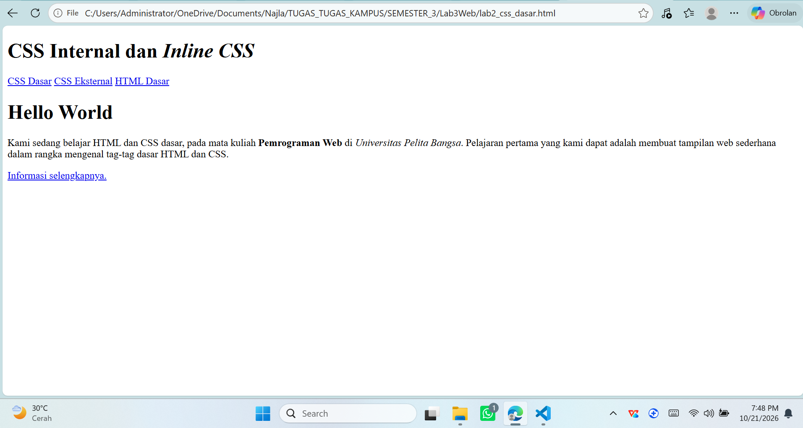

---

## Langkah 2: Mendeklarasikan CSS Internal

CSS internal ditulis di dalam tag `<style>` pada bagian `<head>`. Aturan yang ditambahkan:

- `body`: mengatur font halaman.
- `header`: tinggi minimum dan garis bawah berwarna biru muda.
- `h1`: ukuran, warna, rata tengah, dan padding judul.
- `h1 i`: teks miring di dalam `h1` berwarna abu-abu.

```html
<head>
    <meta charset="UTF-8">
    <meta name="viewport" content="width=device-width, initial-scale=1.0">
    <title>CSS Dasar</title>
    <style>
        body {
            font-family: 'Open Sans', sans-serif;
        }
        header {
            min-height: 80px;
            border-bottom: 1px solid #77CCEF;
        }
        h1 {
            font-size: 24px;
            color: #0F189F;
            text-align: center;
            padding: 20px 10px;
        }
        h1 i {
            color: #6d6a6b;
        }
    </style>
</head>
```

**Hasil di browser:** judul menjadi biru tua, rata tengah, dan kata "Inline CSS" berwarna abu-abu. Header memiliki garis bawah biru muda.

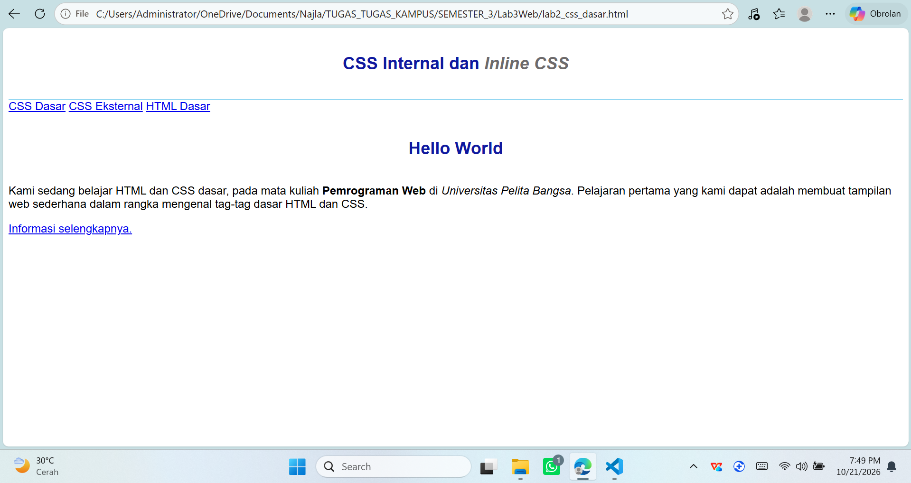

---

## Langkah 3: Menambahkan Inline CSS

Inline CSS ditulis langsung pada atribut `style` di tag HTML. Pada langkah ini, tag `<p>` di dalam `#intro` diberi gaya rata tengah dan warna `#ccd8e4`.

```html
<p style="text-align: center; color: #ccd8e4;">Kami sedang belajar HTML dan CSS dasar, pada mata kuliah
<b>Pemrograman Web</b> di <i>Universitas Pelita Bangsa</i>. Pelajaran pertama
yang kami dapat adalah membuat tampilan web sederhana dalam rangka mengenal
tag-tag dasar HTML dan CSS.</p>
```

**Hasil di browser:** paragraf menjadi rata tengah dengan warna yang sangat pucat (hampir tidak terbaca di latar putih). Inline CSS hanya memengaruhi satu elemen `<p>` ini saja.

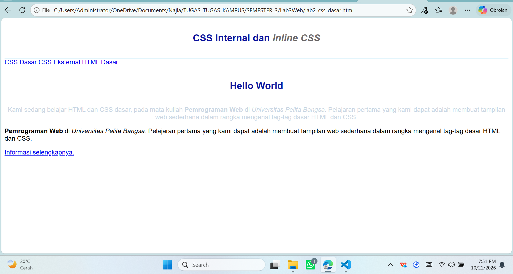

---

## Langkah 4: Membuat CSS Eksternal

CSS eksternal ditulis di file terpisah, yaitu `style_eksternal.css`, lalu dihubungkan ke HTML memakai tag `<link>` di dalam `<head>`.

**`style_eksternal.css`:**

```css
nav {
    background: #20A759;
    color: #fff;
    padding: 10px;
}
nav a {
    color: #fff;
    text-decoration: none;
    padding: 10px 20px;
}
nav .active,
nav a:hover {
    background: #0B6B3A;
}
```

**Tambahan di `<head>` file HTML:**

```html
<!-- menyisipkan css eksternal -->
<link rel="stylesheet" href="style_eksternal.css" type="text/css">
```

**Isi file `style_eksternal.css` di VSCode:**

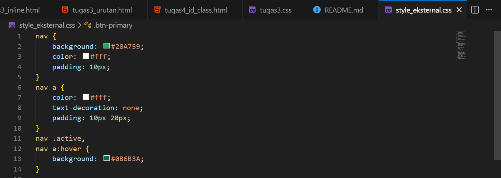

**Hasil di browser:** menu navigasi berubah menjadi bilah berwarna hijau dengan teks putih tanpa garis bawah. Saat kursor diarahkan ke menu, warna latarnya menjadi hijau lebih gelap.

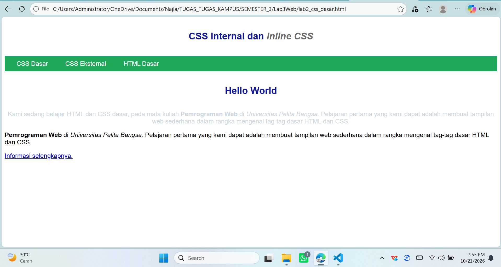

---

## Langkah 5: Menambahkan CSS Selector (ID dan Class)

Menambahkan dua jenis selector pada `style_eksternal.css`:

- **ID selector** (`#intro`): diawali tanda `#`, berlaku untuk elemen dengan `id="intro"`.
- **Class selector** (`.button`, `.btn-primary`): diawali tanda titik, berlaku untuk semua elemen yang memakai class tersebut. Satu elemen dapat memiliki lebih dari satu class (`class="button btn-primary"`).

**Tambahan pada `style_eksternal.css`:**

```css
/* ID Selector */
#intro {
    background: #418fb1;
    border: 1px solid #099249;
    min-height: 100px;
    padding: 10px;
}
#intro h1 {
    text-align: left;
    border: 0;
    color: #fff;
}

/* Class Selector */
.button {
    padding: 15px 20px;
    background: #bebcbd;
    color: #fff;
    display: inline-block;
    margin: 10px;
    text-decoration: none;
}
.btn-primary {
    background: #E42A42;
}
```

**Isi file `style_eksternal.css` di VSCode:**

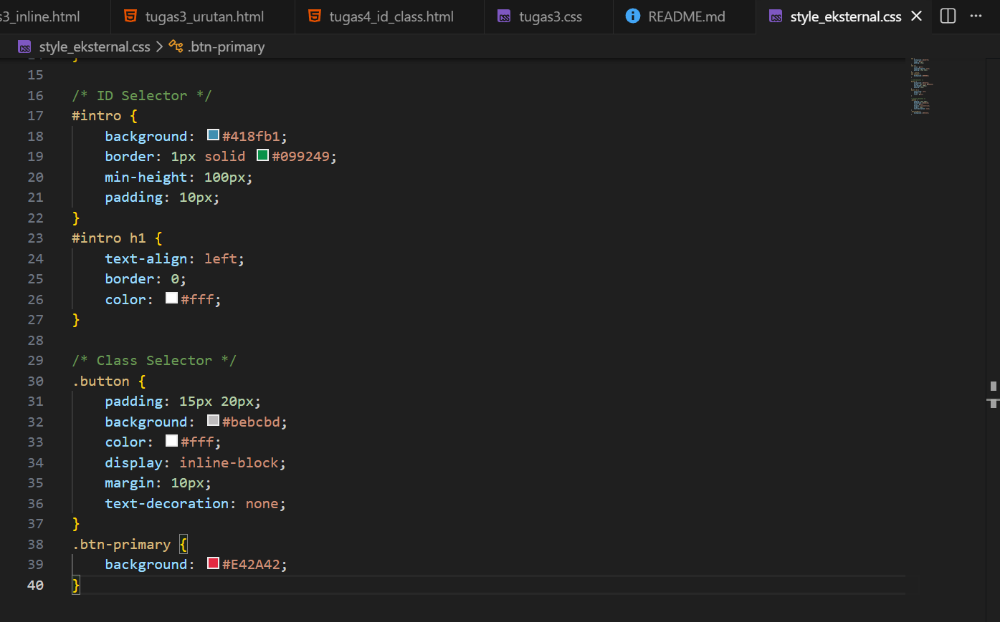

**Hasil di browser:** kotak intro berwarna biru dengan border hijau. Judul "Hello World" menjadi putih dan rata kiri. Link "Informasi selengkapnya." tampil sebagai tombol merah.

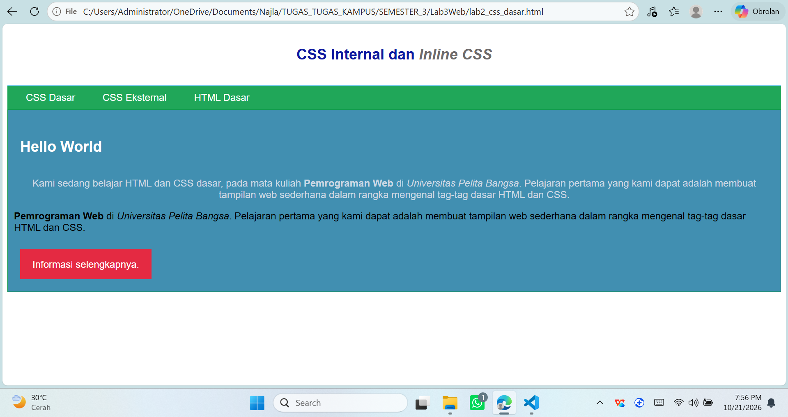

---

## Tugas 1: Eksperimen Mengubah dan Menambah Properti CSS

Eksperimen dilakukan dengan mengubah dan menambah properti dari kode Langkah 5.

### CSS Internal (di `lab2_css_dasar.html`) setelah eksperimen

```css
body {
    font-family: 'Open Sans', sans-serif;
    margin: 0;
    line-height: 1.6;
    background-color: #f4f7fa;
}
header {
    min-height: 80px;
    border-bottom: 3px solid #77CCEF;
    background-color: #ffffff;
    box-shadow: 0 2px 6px rgba(0,0,0,0.1);
}
h1 {
    font-size: 32px;
    color: #0F189F;
    text-align: center;
    padding: 20px 10px;
    text-transform: uppercase;
    letter-spacing: 2px;
}
h1 i {
    color: #6d6a6b;
}
```

### CSS Eksternal (`style_eksternal.css`) setelah eksperimen

```css
nav {
    background: #20A759;
    color: #fff;
    padding: 10px;
    font-weight: bold;
}
nav a {
    color: #fff;
    text-decoration: none;
    padding: 10px 20px;
    border-radius: 5px;
    transition: background 0.3s;
}
nav .active,
nav a:hover {
    background: #0B6B3A;
}

/* ID Selector */
#intro {
    background: #418fb1;
    border: 2px solid #099249;
    min-height: 100px;
    padding: 20px;
    border-radius: 10px;
    box-shadow: 0 4px 10px rgba(0,0,0,0.25);
    margin: 20px;
}
#intro h1 {
    text-align: left;
    border: 0;
    color: #fff;
    text-transform: none;
    letter-spacing: normal;
}

/* Class Selector */
.button {
    padding: 15px 20px;
    background: #bebcbd;
    color: #fff;
    display: inline-block;
    margin: 10px;
    text-decoration: none;
    border-radius: 8px;
    font-weight: bold;
    transition: all 0.3s;
}
.button:hover {
    opacity: 0.85;
    transform: translateY(-3px);
}
.btn-primary {
    background: #E42A42;
}
.btn-secondary {
    background: #6c757d;
}
```

**Isi file `style_eksternal.css` setelah eksperimen:**


### Perubahan pada HTML

```html
<p style="text-align: center; color: #ffffff;">...</p>

<a class="button btn-primary" href="#intro">Informasi selengkapnya.</a>
<a class="button btn-secondary" href="#intro">Tombol Kedua</a>
```

### Tabel Perubahan

| No | Selector | Properti | Sebelum | Sesudah | Efek |
|----|----------|----------|---------|---------|------|
| 1 | body | background-color, line-height, margin | tidak ada | #f4f7fa, 1.6, 0 | Latar abu muda, teks lebih lega |
| 2 | header | box-shadow, background-color, border-bottom | 1px | 3px + bayangan | Header lebih menonjol |
| 3 | h1 | font-size | 24px | 32px | Judul lebih besar |
| 4 | h1 | text-transform, letter-spacing | normal | uppercase, 2px | Judul kapital dan renggang |
| 5 | nav | font-weight | normal | bold | Teks menu tebal |
| 6 | nav a | border-radius, transition | tidak ada | 5px, 0.3s | Menu membulat, hover halus |
| 7 | #intro | padding, border, border-radius, box-shadow, margin | 10px, 1px | 20px, 2px, 10px, bayangan | Kotak intro lebih lega dan bergaya kartu |
| 8 | #intro h1 | text-transform, letter-spacing | mewarisi h1 | none, normal | Menimpa aturan h1 global |
| 9 | .button | border-radius, font-weight, transition | tidak ada | 8px, bold, 0.3s | Tombol membulat dan tebal |
| 10 | .button:hover | opacity, transform | tidak ada | 0.85, naik 3px | Tombol bergerak saat disorot |
| 11 | .btn-secondary | background | tidak ada (class baru) | #6c757d | Tombol kedua berwarna abu |
| 12 | p (inline) | color | #ccd8e4 | #ffffff | Teks paragraf terbaca jelas |

**Screenshot sebelum (Langkah 5):**


**Screenshot sesudah eksperimen:**

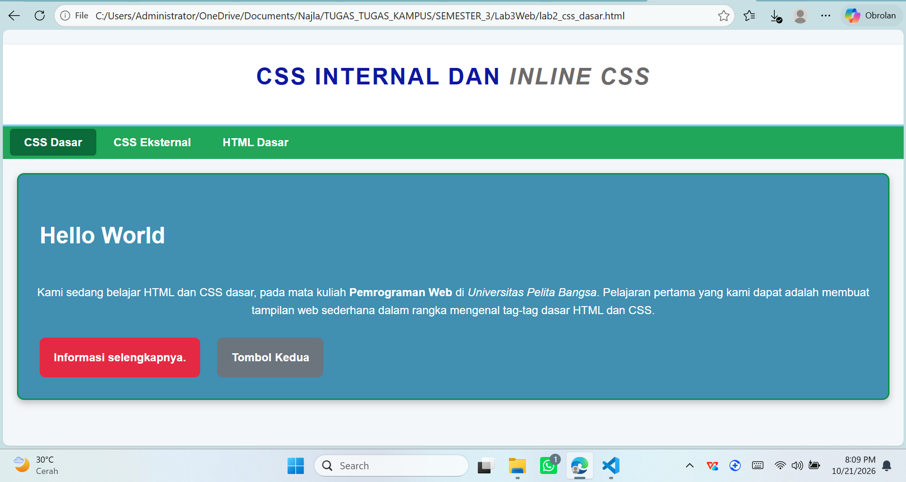

**Screenshot efek hover:**

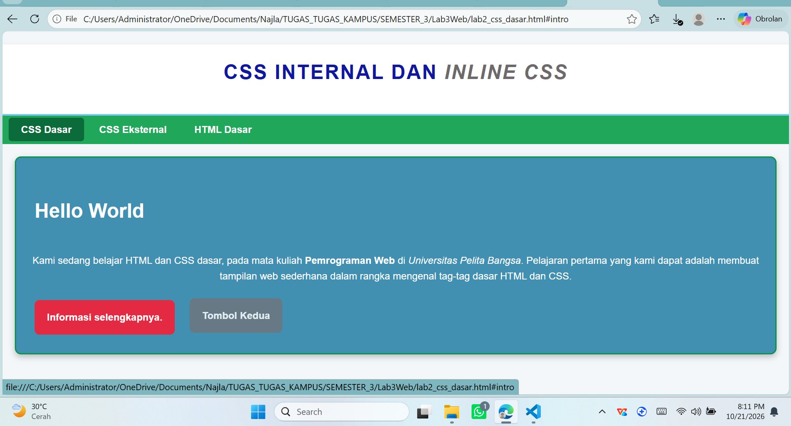

---

## Tugas 2: Perbedaan `h1 {...}` dengan `#intro h1 {...}`

**Jawaban:**

- `h1 {...}` adalah **element selector**. Aturannya berlaku untuk **semua** tag `<h1>` di seluruh halaman.
- `#intro h1 {...}` adalah **descendant selector** (gabungan ID selector dan element selector). Aturannya hanya berlaku untuk tag `<h1>` yang berada **di dalam elemen ber-id `intro`**.
- Specificity `#intro h1` lebih tinggi daripada `h1` (ID bernilai lebih besar daripada elemen). Jika kedua aturan mengatur properti yang sama pada elemen yang sama, aturan `#intro h1` yang dipakai browser.

**Contoh pada praktikum ini:**

```css
h1 {
    color: #0F189F;
    text-align: center;
    text-transform: uppercase;
}
#intro h1 {
    color: #fff;
    text-align: left;
    text-transform: none;
}
```

- `<h1>` di dalam `<header>` ("CSS Internal dan Inline CSS") memakai aturan `h1`: biru tua, rata tengah, kapital.
- `<h1>` di dalam `<div id="intro">` ("Hello World") memakai aturan `#intro h1`: putih, rata kiri, huruf normal.

Keduanya sama-sama tag `<h1>`, tetapi tampilannya berbeda karena selector yang berlaku berbeda.

---

## Tugas 3: CSS Internal, Eksternal, dan Inline pada Elemen yang Sama

**Jawaban:**

Yang ditampilkan browser adalah **inline CSS**, karena inline memiliki prioritas tertinggi. Urutan prioritasnya:

```
Inline  >  Internal / Eksternal (sama kuat, ditentukan urutan)
```

Untuk internal dan eksternal, keduanya memiliki tingkat prioritas yang sama. Jika selector-nya sama, yang **ditulis atau dimuat paling akhir** yang menang (prinsip *cascade*). Artinya, jika `<link>` eksternal berada **di bawah** `<style>` internal, maka eksternal yang menang. Jika `<link>` berada **di atas** `<style>`, maka internal yang menang.

### Ketiga jenis CSS pada percobaan ini

| Jenis | Kode | Warna | Letaknya |
|---|---|---|---|
| Eksternal | `p { color: green; }` | hijau | file terpisah `tugas3.css`, dipanggil dengan `<link>` |
| Internal | `p { color: blue; }` | biru | di dalam `<style>` pada `<head>` |
| Inline | `style="color: red;"` | merah | langsung di tag `<p>` |

### File `tugas3.css` (CSS eksternal)

```css
p { color: green; }
```

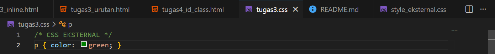

### Percobaan A: `<link>` eksternal di ATAS `<style>` internal (`tugas3.html`)

```html
<!DOCTYPE html>
<html lang="id">
<head>
    <meta charset="UTF-8">
    <title>Tugas 3</title>

    <!-- 1. EKSTERNAL dimuat PERTAMA -->
    <link rel="stylesheet" href="tugas3.css">

    <!-- 2. INTERNAL dimuat KEDUA -->
    <style>
        p { color: blue; }
    </style>
</head>
<body>
    <h2>Tugas 3: &lt;link&gt; eksternal di ATAS &lt;style&gt; internal</h2>

    <p>Paragraf 1 (tanpa inline) -> hasil BIRU, internal menang karena ditulis terakhir.</p>

    <!-- 3. INLINE -->
    <p style="color: red;">Paragraf 2 (dengan inline) -> hasil MERAH, inline prioritas tertinggi.</p>
</body>
</html>
```

**Hasil:** paragraf 1 **biru** (internal ditulis setelah eksternal), paragraf 2 **merah** (inline).

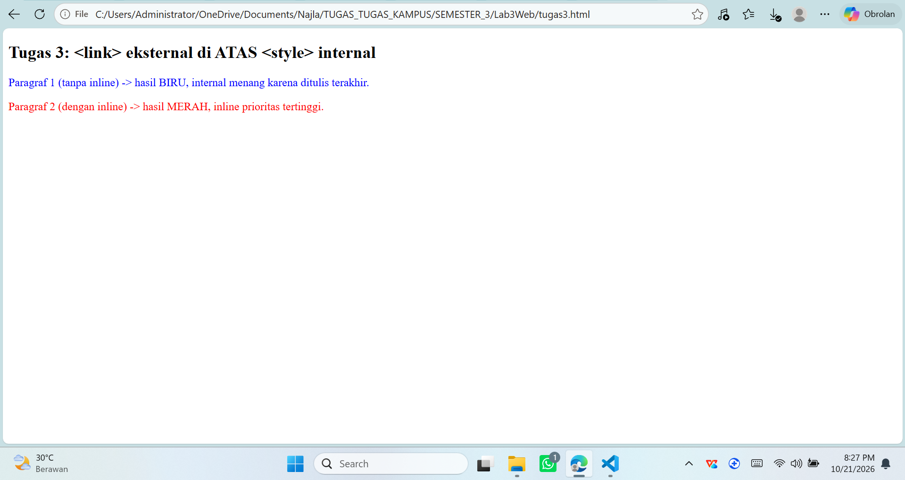

### Percobaan B: `<link>` eksternal di BAWAH `<style>` internal (`tugas3dibalik.html`)

```html
<!DOCTYPE html>
<html lang="id">
<head>
    <meta charset="UTF-8">
    <title>Tugas 3 (dibalik)</title>

    <!-- 1. INTERNAL dimuat PERTAMA -->
    <style>
        p { color: blue; }
    </style>

    <!-- 2. EKSTERNAL dimuat KEDUA -->
    <link rel="stylesheet" href="tugas3.css">
</head>
<body>
    <h2>Tugas 3 (urutan dibalik): &lt;link&gt; eksternal di BAWAH &lt;style&gt; internal</h2>

    <p>Paragraf 1 (tanpa inline) -> hasil HIJAU, eksternal menang karena ditulis terakhir.</p>

    <!-- 3. INLINE -->
    <p style="color: red;">Paragraf 2 (dengan inline) -> hasil MERAH, inline tetap menang.</p>
</body>
</html>
```

**Hasil:** paragraf 1 **hijau** (eksternal ditulis setelah internal), paragraf 2 tetap **merah** (inline).

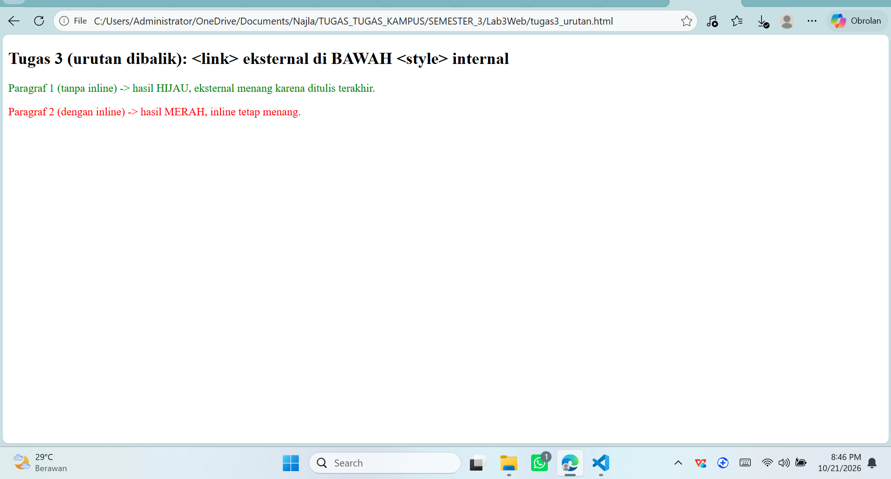

### Kesimpulan Tugas 3

| Paragraf | Percobaan A | Percobaan B | Alasan |
|---|---|---|---|
| Paragraf 1 (tanpa inline) | biru | hijau | Internal dan eksternal sama kuat, yang ditulis terakhir menang |
| Paragraf 2 (dengan inline) | merah | merah | Inline prioritas tertinggi, selalu menang |

---

## Tugas 4: ID dan Class pada Satu Elemen

Elemen: `<p id="paragraf-1" class="textparagraf">`

**Jawaban:**

Yang ditampilkan browser adalah deklarasi dari **ID selector**, karena specificity ID lebih tinggi daripada class. Urutan specificity dari yang tertinggi:

```
Inline  >  ID (#)  >  Class (.)  >  Element
```

Prioritas ini berlaku **walaupun** class ditulis lebih akhir daripada ID di dalam file CSS.

### File `tugas4.html`

```html
<!DOCTYPE html>
<html lang="id">
<head>
    <meta charset="UTF-8">
    <title>Tugas 4</title>
    <style>
        #paragraf-1 {
            color: red;
        }
        /* Class sengaja ditulis SETELAH id, tetap kalah */
        .textparagraf {
            color: blue;
            font-size: 22px;
        }
    </style>
</head>
<body>
    <h2>Tugas 4: ID vs Class pada satu elemen</h2>
    <p id="paragraf-1" class="textparagraf">Elemen ini punya id DAN class -> warna MERAH (dari ID), ukuran 22px (dari class, karena tidak bentrok).</p>
    <p class="textparagraf">Elemen ini hanya punya class -> warna BIRU.</p>
</body>
</html>
```

**Hasil:** paragraf pertama tampil **merah** (dari `#paragraf-1`), bukan biru, meskipun `.textparagraf` ditulis setelahnya. Properti yang tidak bentrok tetap digabung: `font-size: 22px` dari class tetap dipakai. Paragraf kedua yang hanya punya class tampil **biru**.

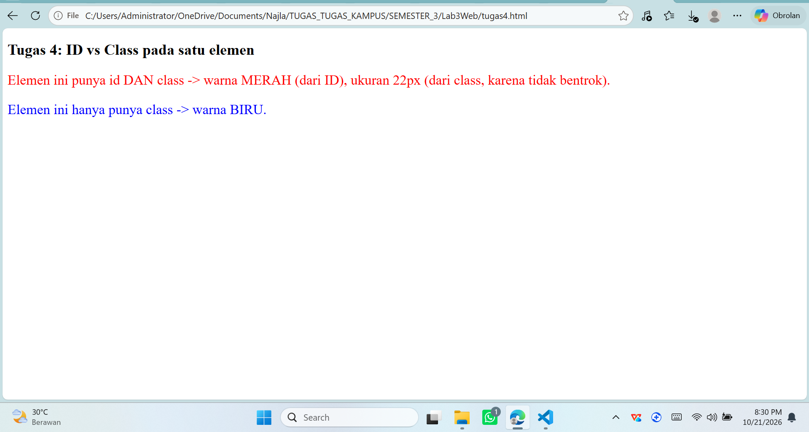

| Elemen | Warna | Alasan |
|---|---|---|
| `id="paragraf-1" class="textparagraf"` | merah | ID lebih kuat daripada class |
| hanya `class="textparagraf"` | biru | hanya class yang berlaku |

---

## Validasi CSS

Validasi dilakukan pada https://jigsaw.w3.org/css-validator/ dengan mengunggah file `style_eksternal.css`.

**Hasil validasi:** (isi sesuai hasil, misalnya "Congratulations! No Error Found." atau jelaskan error/warning yang muncul dan cara memperbaikinya)

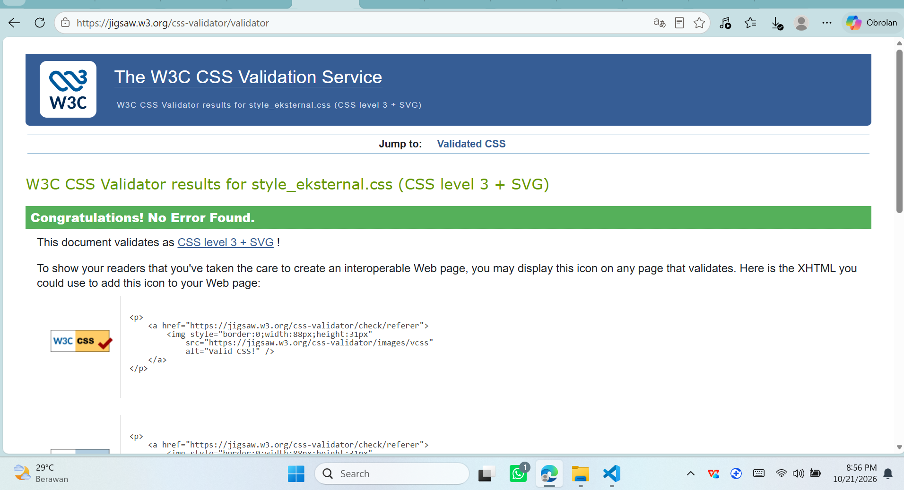

---

## Kesimpulan

1. CSS terdiri dari **selector** dan **declaration** (property dan value).
2. CSS dapat ditulis dengan tiga cara: **inline**, **internal** (`<style>`), dan **eksternal** (`<link>` ke file `.css`). CSS eksternal paling efisien karena satu file dapat dipakai banyak halaman.
3. Selector yang dipelajari: **element**, **class** (`.`), dan **ID** (`#`). Class bisa dipakai berulang dan lebih dari satu per elemen, sedangkan ID hanya untuk satu elemen.
4. Ketika beberapa aturan bentrok, browser memilih berdasarkan **specificity** dan **urutan penulisan**: inline > ID > class > element.

---

## Referensi

- Modul Praktikum Pemrograman Web: Praktikum 3 CSS Dasar, Sufajar Butsianto, Universitas Pelita Bangsa.
- W3C CSS Validator: https://jigsaw.w3.org/css-validator/